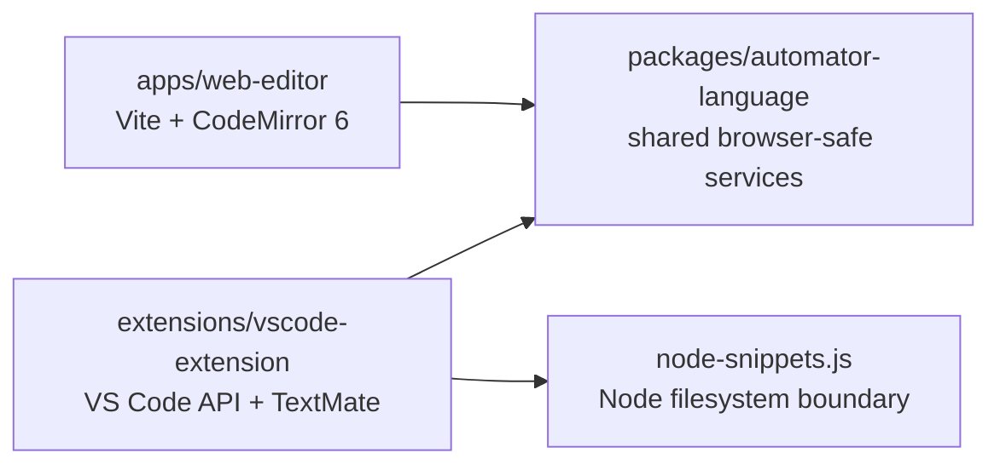

# Technical Overview

## Architecture

The repository is a pnpm workspace. Editor integrations depend on `packages/automator-language` for shared behavior; editor-specific code adapts those services to VS Code or CodeMirror.

### Workspace packages

- **`packages/automator-language`** is CommonJS JavaScript with TypeScript declarations for the APIs used by the web app. Its package exports are:
  - `@adme/automator-language`: validation, completions, character counting, formatting, metadata, and the shared tokenizer export.
  - `@adme/automator-language/highlighting`: browser-safe line tokenization used by both adapters.
  - `@adme/automator-language/node-snippets`: filesystem-backed snippet expansion for the VS Code extension only.
- **`apps/web-editor`** is a TypeScript/Vite single-page app. CodeMirror 6 provides the editing surface, history, completion UI, and lint diagnostics. Vite prebundles the linked CommonJS workspace entries during development so browsers receive ESM-compatible modules.
- **`extensions/vscode-extension`** adapts shared language behavior to VS Code diagnostics, completions, semantic tokens, status-bar character counts, formatting, and snippet commands. The TextMate grammar remains its fallback grammar and provides theme scopes.

The shared language entry does not load Node filesystem modules. VSIX prepublish copies `index.js`, `highlighting.js`, and `node-snippets.js` into `extensions/vscode-extension/vendor/automator-language`; the packaged extension uses that vendor copy when the workspace package is not available. The vendor directory and generated VSIX are build artifacts and are ignored by Git.

## Shared language behavior

### Highlighting

`tokenizeAutomatorLine` produces source spans with shared categories such as `control`, `command`, `subcommand`, `modifier`, `currency`, `constant`, `number`, `operator`, `comment`, `string`, and `punctuation`. The web adapter maps them to CodeMirror highlight tags and the VS Code adapter publishes semantic tokens mapped to TextMate scopes.

The tokenizer is deliberately line-based. It does not parse or prove that an entire script is valid. Snippet references are recognized only when the extension opts in; the browser leaves `{name}` references as ordinary source text.

### Validation and diagnostics

`validate(source)` returns diagnostics with zero-based line and column positions, a message, and severity. The current validator checks supported command forms and arguments, supported block structures, comparison syntax, and the game's 10,000-character script limit.

The validator does not execute scripts, verify the current game state, confirm that variables are defined, validate a study tree, or certify runtime behavior. The browser displays the results as CodeMirror lint diagnostics and an Issues list with a reminder of these limits. It does not invent warnings beyond the shared validator's results.

### Completions

`completionItems(linePrefix)` returns context-aware suggestions with labels, details, insertion text, and optional replacement hints. Both editors adapt this shared result. The browser filters suggestions against the current argument prefix and avoids showing them inside comments and strings. Suggestions are not a complete grammar or a guarantee that the game accepts the selected input.

VS Code snippet-name completion is part of its adapter. Browser snippet completion, import, and expansion are intentionally excluded from the first web release.

### Formatting

`formatScript(source, indentSize = 2)` adjusts leading indentation for recognized blocks while preserving command contents and other source text. It refuses malformed or unsupported block structure by throwing `FormattingError`. Both integrations apply a successful edit as one undoable operation.

### Snippet expansion

`node-snippets.js` resolves `.snippet` and `.snpt` files from an adjacent `ext` directory, supports nested references, and reports missing files and cycles. This is a Node-only VS Code build feature. The source script is not overwritten; expansion creates a sibling `.built.automator` file.

## Web editor

The app's source is in `apps/web-editor/src`:

- `main.ts` creates the page shell, toolbar, draft-recovery prompt, and status feedback areas.
- `editor.ts` configures CodeMirror, themes, shared completions, linting, diagnostics, clipboard/file actions, and formatting.
- `automator-language.ts` adapts shared token spans to CodeMirror stream tokens.
- `storage.ts` reads and writes local browser drafts with failure handling.
- `styles.css` contains the responsive dark theme and touch-oriented completion/diagnostics UI.

Document edits are autosaved to `localStorage` after a short debounce and flushed when the page is closed. Startup draft recovery is an explicit Restore/Dismiss choice; it does not replace the current initial script automatically. Clipboard read/write calls are made only from user-triggered actions and report permission failures in the status area. Import reads plain text, export downloads plain text, and **Format script** calls the shared leading-indentation formatter as one editor transaction.

Run locally with `corepack pnpm --filter @adme/web-editor dev`; build with `corepack pnpm --filter @adme/web-editor build`. The build output is `apps/web-editor/dist`.

Vite's `base` defaults to `/`. Set `VITE_BASE_PATH` at build time to serve from a repository subpath, such as `/repository-name/`. No GitHub Pages workflow or production deployment configuration is present yet. Local development and preview details are in [apps/web-editor/README.md](apps/web-editor/README.md).

## VS Code extension

The extension entry point is `extensions/vscode-extension/extension.js`. It registers the Automator language, diagnostics, completion provider, semantic highlighting, character-count status bar, formatter command, and snippet build command. Language metadata and grammar are in `package.json`, `language-configuration.json`, and `syntaxes/automator.tmLanguage.json`.

Run the extension in a development host by opening `extensions/vscode-extension` in VS Code and pressing `F5`. Package it from the repository root with `corepack pnpm package:vscode`; output goes to `bin/`. See [the extension README](extensions/vscode-extension/README.md) and [language reference](extensions/vscode-extension/AUTOMATOR-LANGUAGE.md).

## Tests and fixtures

The shared Node test suite is `packages/automator-language/test/automator.test.js`. Run it from the repository root with `corepack pnpm test`. It covers validation, completion behavior, formatting preservation/refusal, snippet expansion, highlighting categories, and representative `.aut` examples under `extensions/vscode-extension/Examples`.

Use the real Automator examples and language reference as fixtures when changing editor behavior. The reference and older syntax notes document more than the validator can establish; implementation and diagnostics must follow the actual shared code.

## Change guidance

When changing language behavior:

1. Update the shared service in `packages/automator-language` rather than implementing separate language rules in each editor.
2. Update the JavaScript declaration file when changing the shared public API.
3. Adapt and review both editor integrations. For new token categories, update the CodeMirror tag mapping, VS Code semantic scope mapping, and TextMate fallback grammar.
4. Add or adjust cases using focused source strings and representative `.aut` fixtures.
5. Keep runtime-validity claims within the limits of what the shared validator actually checks.

The broader sequence of remaining work and product decisions lives in [IMPLEMENTATION-PLAN.md](IMPLEMENTATION-PLAN.md).
